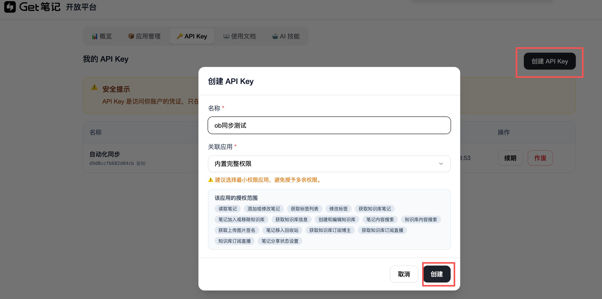
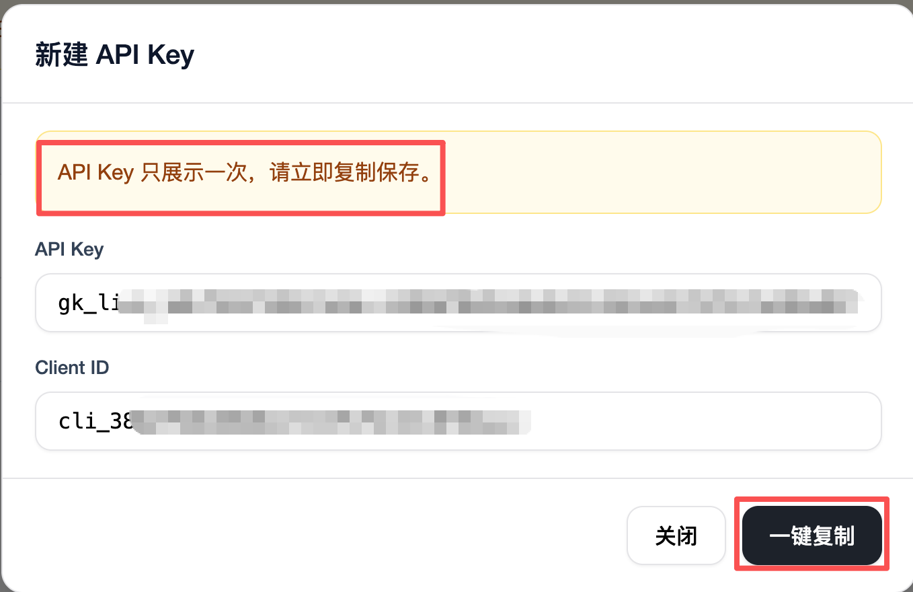
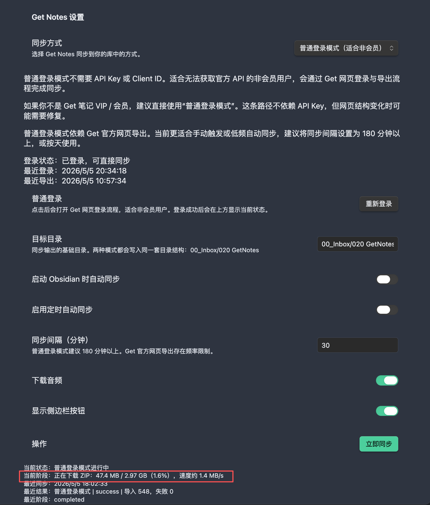

# Obsidian Get Notes

[English](./README.en.md)

[](https://github.com/Jerry-Shan/obsidian-get-notes/releases)
[](https://obsidian.md)
[](./LICENSE)

一个面向真实用户的 Obsidian 桌面插件，用来把 **Get 笔记**同步到你的 Vault。

它支持两种同步入口：

- `API 模式`
  适合已经开通 Get OpenAPI 的用户，数据完整度更高，推荐作为主力同步方式。
- `普通登录模式`
  适合没有 API Key / Client ID 的用户，通过 Get 官方网页导出完成同步，更适合作为低频同步或兼容导入方式。

无论你使用哪种入口，插件最终都会把内容写入 **同一套 Obsidian 目录结构**，而不是拆成两套知识库。

---

## 为什么值得用

- 两种同步模式，统一输出到同一套目录结构
- 统一的 Markdown 渲染与附件组织规则
- 支持手动同步、启动自动同步、定时自动同步
- 支持删除保护：你手动删除的同步笔记不会被自动恢复
- 支持幂等同步：相同内容不会反复改写文件或重复生成附件
- 普通登录模式支持大 ZIP 下载、阶段反馈和下载进度提示
- 支持 dry-run 迁移报告，方便从旧目录结构过渡
- raw cache、同步状态、迁移报告保存在插件私有目录，不污染你的笔记目录

---

## 功能概览

### API 模式

- 使用 `API Key` + `Client ID` 直接同步 Get OpenAPI
- 支持全量首次同步与后续增量同步
- 音频、会议类内容通常比普通登录模式更完整
- 支持本地 raw cache
- 支持从缓存重建结果

### 普通登录模式

- 不需要 API Key
- 通过 Get 官方网页登录与导出流程完成同步
- 优先复用最近一次导出，减少频率限制影响
- 支持超大 ZIP 下载与系统级解压
- 支持阶段反馈与下载进度提示
- 如果本地存在 API raw cache，会尽量用于补齐普通登录模式的结果

---

## 模式对比

| 维度 | API 模式 | 普通登录模式 |
| --- | --- | --- |
| 适合人群 | 有 OpenAPI 权限的用户 | 没有 API Key 的用户 |
| 数据完整度 | 更高 | 受官方导出内容限制 |
| 同步方式 | API 拉取 | 网页导出 ZIP |
| 速度 | 更快 | 首次可能较慢 |
| 适合频率 | 日常高频同步 | 低频同步 / 导入 / 备份 |
| 推荐程度 | 主力推荐 | 兼容可用 |

一句话建议：

- 能用 API，就优先用 `API 模式`
- 没有 API，也可以直接从 `普通登录模式` 开始

---

## 输出结构

默认目录为 `00_Inbox/020 GetNotes`，同步后会看到：

```text
00_Inbox/020 GetNotes/
  01 语音记录/
  02 多人会议/
  03 纯文本记录/
  04 链接同步摘抄/
  99 其他/
  _assets/
    audio/
    images/
    files/
```

说明：

- `01 语音记录`：语音类笔记
- `02 多人会议`：会议类笔记
- `03 纯文本记录`：纯文本类笔记
- `04 链接同步摘抄`：网页或链接摘抄
- `99 其他`：暂时无法归类的内容
- `_assets`：统一存放音频、图片、文件等附件

---

## 界面预览

### API Key 获取





### 普通登录模式下载进度



---

## 安装

### 前置要求

- `Obsidian 1.6.0` 或更高版本
- 桌面端本地 Vault
- `Playwright`
  只有在使用 `普通登录模式` 时必需；如果你只使用 `API 模式`，可以先不安装
- `Node.js`
  仅在你打算本地构建插件时需要

### 推荐方式：让 Agent 帮你完成配置

如果你已经在使用 Codex、Claude、Qoder、OpenClaw 等 Agent，最推荐的方式是直接让 Agent 帮你：

- 安装或更新插件文件
- 安装 `Playwright`
- 部署到你的 Obsidian Vault 插件目录
- 检查插件是否成功加载

这是当前门槛最低、最省心的方式，尤其适合第一次配置 `普通登录模式` 的用户。

### 方式一：手动安装 Release 文件

适合普通用户，通常不需要自己构建源码。

1. 从最新 [GitHub Release](https://github.com/Jerry-Shan/obsidian-get-notes/releases) 下载：
   - `main.js`
   - `manifest.json`
   - `styles.css`
2. 在你的 Vault 中创建目录：
   `.obsidian/plugins/obsidian-get-notes`
3. 将这三个文件放入该目录
4. 重启 Obsidian
5. 在社区插件页面启用 `Get Notes`

如果你需要使用 `普通登录模式`，还需要额外安装 Playwright：

```bash
npx playwright@1.43.1 install
```

注意：

- `普通登录模式` 依赖 Playwright 完成网页登录和导出自动化
- 如果没有安装 Playwright，`普通登录模式` 无法正常工作
- `API 模式` 不依赖 Playwright

### 方式二：从源码本地构建

适合开发者或希望自己修改插件的人。

1. 克隆仓库

```bash
git clone https://github.com/Jerry-Shan/obsidian-get-notes.git
cd obsidian-get-notes
```

2. 安装依赖

```bash
npm install
```

3. 安装 Playwright（如果你要使用普通登录模式）

```bash
npx playwright@1.43.1 install
```

4. 构建插件

```bash
npm run build
```

5. 将以下文件复制到你的 Vault 插件目录：

- `main.js`
- `manifest.json`
- `styles.css`

目标目录：

```text
.obsidian/plugins/obsidian-get-notes/
```

6. 重启 Obsidian，并启用 `Get Notes`

### Playwright 安装提示

如果你主要使用 `普通登录模式`，请把 Playwright 当成必需依赖。

```bash
npx playwright@1.43.1 install
```

如果安装失败，常见做法包括：

- 重新执行安装命令
- 切换网络环境后重试
- 使用镜像源重试
- 让 Agent 直接帮你完成安装和验证

---

## 快速开始

### 方案 A：你有 API Key / Client ID

1. 打开插件设置
2. 选择 `API 模式`
3. 填写 `API Key`
4. 填写 `Client ID`
5. 点击 `测试连接`
6. 点击 `立即同步`

Get OpenAPI 申请入口：
[https://www.biji.com/openapi?tab=keys](https://www.biji.com/openapi?tab=keys)

### 方案 B：你没有 API Key

1. 打开插件设置
2. 选择 `普通登录模式`
3. 点击 `打开普通登录`
4. 在浏览器中完成 Get 登录
5. 回到 Obsidian 点击 `立即同步`

首次普通登录同步可能会下载很大的全量 ZIP，请耐心等待。这个模式更适合低频同步、导入或备份。

---

## 同步行为

### 插件会做什么

- 把 Get 笔记转换为 Markdown 写入你的 Vault
- 按固定分类目录写入文件
- 把音频、图片、文件统一写入 `_assets`
- 维护插件私有 raw cache、同步状态和迁移报告

### 插件不会做什么

- 不会把 API 原始 JSON 直接暴露到你的笔记目录
- 不会自动恢复你手动删除过的同步笔记
- 不会乱改你自己手动维护的其他文件
- 不会为 API 和普通登录模式分别生成两套最终目录

---

## 已知限制

这部分建议在开始使用前先看一遍。

### 1. 普通登录模式不保证和 API 模式一样完整

这是当前最重要的限制。

原因不完全在插件本身，也在于 Get 官方导出的 HTML / ZIP 内容本身就可能不如 API 丰富。尤其在：

- 音频类笔记
- 多人会议类笔记

普通登录模式拿到的内容有时更接近“总结型文本”，而不是最完整的原始正文。

### 2. 普通登录模式本质上更像“导出快照导入”

它依赖：

- 网页登录
- 官方导出任务
- 大 ZIP 下载
- 本地解压与重建

因此它更适合：

- 低频同步
- 兼容导入
- 备份导入

不建议把它理解成和 API 等价的高频同步方案。

### 3. 普通登录模式仍然依赖 Get 网页结构

如果 Get 官方网页后续改版，普通登录模式可能需要跟着修复。

### 4. Legacy `data-json` 仍有提升空间

当前普通登录模式已经可用、稳定、可同步，但对某些内容类型的完整度提升空间还没有完全榨干。后续会继续迭代这条链路。

---

## 使用建议

### 如果你有 API Key

优先使用 `API 模式`，把它作为长期主力同步方式。

### 如果你没有 API Key

可以直接使用 `普通登录模式` 开始，不需要等到有 API 才能用。

### 如果你现在先用普通登录模式，以后再换 API 模式

可以。

插件已经尽量把两种模式统一到同一套落表结构中，避免维护两套独立知识库。

---

## 常见问题

### 1. 为什么普通登录模式会比较慢？

因为它常常需要：

1. 等待官方导出任务
2. 下载全量 ZIP
3. 解压 ZIP
4. 解析导出内容
5. 重建 Markdown 和附件

这不是“插件卡死”，而是这种同步方式本身的特性。

### 2. 为什么目录暂时没有变化？

这不一定是卡住了。

普通登录模式通常会先完成大 ZIP 下载，之后才进入写文件阶段。现在插件会尽量显示更明确的阶段反馈和下载进度。

### 3. 我手动删除了一篇同步笔记，它会不会又回来？

不会。

插件会把这类情况记为“用户主动删除”，后续不会自动恢复。

### 4. 缓存文件会不会越来越多？

不会无限增长。

普通登录模式的 ZIP 使用固定缓存文件，插件也会定期清理过期的临时目录、调试截图和旧 ZIP。API raw cache 会保留在插件私有目录中，用于重建和补齐结果。

### 5. 插件会不会乱改我的 Vault？

不会。

插件只管理它自己同步出来的 Markdown、附件和插件私有状态，不会主动改动你其他手写文件。

---

## 文档

- 用户指南：[docs/USER_GUIDE.zh-CN.md](docs/USER_GUIDE.zh-CN.md)
- 更新记录：[CHANGELOG.md](CHANGELOG.md)
- 开发说明：[docs/DEVELOPMENT.md](docs/DEVELOPMENT.md)

---

## 开发

```bash
npm install
npm run check
npm run build
npm run preflight
```

更多说明见 [docs/DEVELOPMENT.md](docs/DEVELOPMENT.md)。

---

## 反馈与贡献

如果你遇到问题或有改进建议，欢迎：

- 提交 [Issue](https://github.com/Jerry-Shan/obsidian-get-notes/issues)
- 提交 Pull Request
- 在使用场景、目录结构、同步结果完整度上提出真实反馈

这个插件的目标不是“看起来能跑”，而是成为一个真正适合长期使用的 Get 笔记同步方案。

---

## 致谢

感谢 [Obsidian](https://obsidian.md) 提供强大的知识管理平台。  
感谢 Get 笔记 提供优质的笔记服务。  
感谢类似项目带来的启发，尤其是 [get-to-obsidian](https://github.com/geekhuashan/get-to-obsidian)。  
感谢所有贡献者和使用者的支持与反馈。
